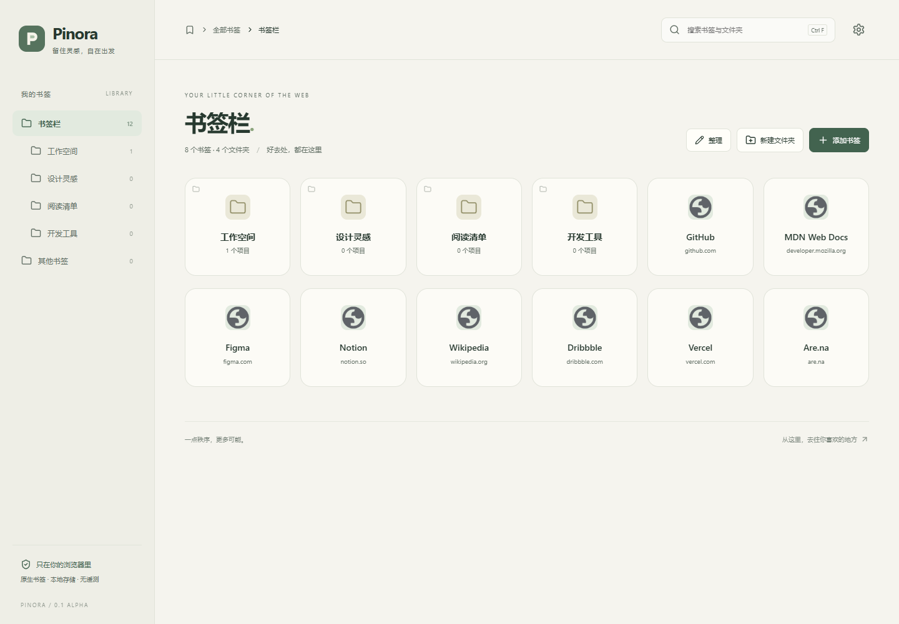

# Pinora 0.0.2

以浏览器原生书签为中心的本地新标签页扩展，适用于 Chrome、Edge 和桌面版 Firefox。无需账户，无广告、无遥测。



## 使用

- **书签首页**：在「外观与设置 → 外观 → 书签文件夹」选择首页目录。支持子文件夹导航、返回上级和目录范围内搜索。
- **紧凑布局**：“书签”标题、搜索框与设置按钮同排，卡片紧接下方；不显示数量与整理工具栏。
- **书签管理**：右键菜单可编辑、删除、移动书签和设置图标，也可重命名或删除已有文件夹；支持同目录拖拽排序和拖入文件夹。修改直接作用于浏览器书签。
- **新增书签**：使用浏览器原生收藏入口或书签管理器；空文件夹仍提供“添加第一个书签”。
- **历史记录与热门网站**：在「外观与设置 → 布局 → 主页内容」分别设置显隐、展示 1–4 行，并获取相应权限。历史记录显示为“最近访问”；热门网站来自浏览器的常访网站列表。两个区域显示在首页书签下方，搜索或进入子文件夹时隐藏。
- **外观自定义**：浅色、深色、跟随系统；调整卡片、图标、间距、圆角、文字及内容宽度；使用纯色、渐变或本地壁纸，并设置适配方式、模糊、亮度和遮罩。

Ctrl / Cmd + F 搜索；方向键移动卡片焦点；Enter 打开；F2 编辑；Delete 打开删除确认；Esc 关闭弹窗或返回上层。中键或 Ctrl / Cmd 点击在后台打开，Shift 点击在新标签页打开。

## 安装到 Chrome / Edge

1. 从 GitHub 仓库的 Releases 页面下载最新的 `Pinora-<版本>.zip`，解压到一个固定目录。
2. 打开 `chrome://extensions` 或 `edge://extensions`，开启“开发者模式”。
3. 选择“加载已解压的扩展”，选中解压后的目录。
4. 新建标签页，在设置中选择要展示的书签文件夹。

升级时下载新版本覆盖解压目录，在扩展管理页点击“重新加载”，再刷新已打开的新标签页。

## 安装到 Firefox

桌面版 Firefox 140 或更新版本可使用 Firefox 专用的 `.xpi` 文件。本地运行 `npm run package:firefox`，生成 `artifacts/Pinora-<版本>-firefox.xpi`。该命令生成的是未签名包，按以下步骤临时安装：

1. 打开 `about:debugging#/runtime/this-firefox`。
2. 点击“临时载入附加组件”，选择 `.xpi` 文件，无需解压。
3. 打开新标签页。在 Firefox 询问是否保留新标签页更改时，选择保留。

临时安装在重启 Firefox 后失效。要长期安装，可在 [Mozilla 附加组件平台](https://addons.mozilla.org/developers/addon/submit/)选择 **On your own（自行分发）**，申请非公开签名。提交 `.xpi` 时还需提供源码压缩包、依赖锁文件和构建说明，详见[官方提交流程](https://extensionworkshop.com/documentation/publish/submitting-an-add-on/#self-distribution)。

下载签名后的 `.xpi`，打开 `about:addons`，从齿轮菜单选择“从文件安装附加组件”进行安装。签名包在重启后仍会保留。

Firefox 没有 Chromium 的本地网站图标接口，因此默认显示占位图标，自定义图标仍可使用。

## 数据与权限

基础权限为 `bookmarks` 和 `storage`，分别用于原生书签和本地设置。Chrome／Edge 另用 `favicon` 读取浏览器本地网站图标。可选权限 `history`、`topSites` 仅在设置中点击授权后获取，分别用于最近访问和热门网站；未授权不读取，撤销权限后清空对应显示。

Pinora 不上传书签、历史记录或常访网站列表。设置、自定义图标和壁纸仅保存在本机；历史记录和热门网站只读取到页面内存，不另行持久化。浏览器自身启用的书签同步仍由浏览器管理。设置变更会同步到同一浏览器配置文件中已打开的新标签页。

删除书签会影响浏览器原生数据，删除非空文件夹需要确认。完整说明见[隐私说明](public/privacy.md)。

## 开发与验证

需要 Node.js 22+。在项目目录执行：

```powershell
npm ci
npm run check
npx playwright install chromium
npm run test:e2e
```

`npm run check` 执行类型检查、Lint、单元测试和生产构建，输出到 `dist`。E2E 使用已构建的 `dist` 和独立测试配置文件；修改源码后先构建。验证结果和限制见[验证记录](docs/validation.md)。

### 本地调试

Chrome／Edge 本地开发无需打包：在扩展管理页开启“开发者模式”，通过“加载已解压的扩展”选择项目的 `dist` 目录。保留这个目录，浏览器运行时仍会读取其中的文件。修改源码后执行 `npm run build`，再在扩展管理页点击“重新加载”并刷新新标签页。Firefox 使用上面的专用包安装流程。

```powershell
npm run dev
```

打开[开发预览](http://127.0.0.1:5173/?preview=1)。预览使用明确标识的合成书签，刷新后重置，不代表浏览器原生 API 验收。

### 发布

```powershell
npm run package:extension
npm run package:firefox
```

打包命令需要 PowerShell，都会先构建：

- `package:extension` 生成供 Chrome／Edge 使用的 `artifacts/Pinora-<版本>.zip`。
- `package:firefox` 生成供 Firefox 使用的未签名包 `artifacts/Pinora-<版本>-firefox.xpi`。Firefox 专用配置仅写入该包，不修改 `dist` 中的 Chrome／Edge 配置。

安装包不纳入版本控制。发布时将 `.zip` 或签名后的 `.xpi` 上传到 GitHub Release，供用户下载安装。

`artifacts/` 仅跟踪下方链接的三张展示截图。测试生成的验收 JSON、浏览器截图、发布记录和安装包均留在本地；需要归档的发布证据可随对应 GitHub Release 上传。

### 商店提交材料

运行 `npm.cmd run package:submission`，再运行 `node scripts/capture-store-assets.mjs`，生成 `artifacts/submission/Pinora-0.0.2/`：包括 Edge ZIP、Firefox XPI、审核源码 ZIP、构建说明、商店文案、权限用途、审核备注、图标和 1280×800 截图。素材脚本使用安装在本机的 Edge 和独立测试档案。

上传文件、公开隐私链接和表单填写说明见[商店提交指南](docs/store/README.md)。Firefox XPI 需由 Mozilla 签名后才能正式分发；源码包与对应 XPI 一同提交审核。

## 项目资料

- [架构](docs/architecture.md)、[界面与接口契约](docs/ui-contract.md)
- [验证记录](docs/validation.md)
- [浅色截图](artifacts/pinora-light.png)、[深色截图](artifacts/pinora-dark.png)、[设置截图](artifacts/pinora-settings.png)
- [隐私说明](public/privacy.md)、[第三方许可](public/THIRD_PARTY_NOTICES.md)

截图中的书签为隔离测试配置文件里的合成样例。
