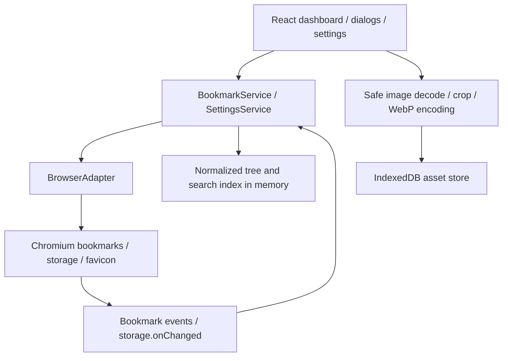

# Pinora architecture

Independent clean-room implementation based solely on supplied behavior specification; no third-party extension source or assets were accessed. Pinora is a development name, not a cleared store trademark.

React UI → domain services → BrowserAdapter → native Chromium or Firefox bookmarks/storage. Raw bookmarks are browser-owned; the extension stores no competing bookmark database. A normalized Map/tree and prebuilt search index exist only in memory. Browser events refresh snapshots; request generations suppress stale responses. System protection is derived from structure and metadata, never specific IDs.

Settings schema v1 validates every persisted field; migrations normalize legacy unversioned values and preserve recoverable originals. Small settings and custom-image mappings live in chrome.storage.local; processed image blobs live in IndexedDB. Local appearance hint is disposable. `history` and `topSites` are optional permissions requested from their settings buttons; downloaded browser data is read in memory only. Manifest CSP denies network connections, allows local/blob/data images and locally bundled code. Opening a bookmark or content card is explicit browser navigation.

The first-phase UI, folder navigation, favicon/search, native CRUD and drag, settings/themes, custom-icon cropping, local wallpaper, recent visits, top sites, tests and unpacked packaging are implemented. See validation.md for evidence and remaining boundaries. Full-tree event refresh is deliberately simple Alpha behavior; rendering uses 200-item pagination rather than rendering the entire library.

## Boundaries

`src/browser` alone calls browser extension APIs. Firefox uses its Promise-based `browser` namespace and falls back to placeholder icons without Chromium's local favicon API. Its bookmark separators stay in the tree for native sort positions but are not shown as cards or search results. The explicit web preview adapter uses separate synthetic bookmarks and storage; it is never selected inside an installed extension.

`src/domain` owns editable-node, cycle, URL and snapshot rules. Same-parent forward index adjustment stays in the extension adapter. Native API completion is authoritative; a subsequent read failure surfaces as a refresh error, not an unsuccessful save that encourages duplicate creation.

`src/storage` owns schema v1, migration, cross-tab Web Locks, small settings, blobs and image sanitation. Asset writes commit before mapping updates. Failed or cancelled mapping writes remove the new orphan. Successful replacements become eligible for collection only after 24 hours without current or recovery references. Collection and media commits acquire the asset lock before the settings lock; maintenance reads raw settings under that lock and never deletes without cross-tab locking. Race regressions are covered by `src/storage/*.test.ts`, `tests/e2e/media-races.spec.ts` and `tests/e2e/asset-maintenance.spec.ts`.

`src/features/bookmarks` owns drag zones, dialogs, context menus and the grid. `src/features/settings` owns theme/layout controls, the wallpaper layer and image crop editor. React text rendering is used for all bookmark titles; executable URL schemes never appear as actionable native link targets.

## Sources and clean-room record

Development started in an empty directory. The supplied functional specification is preserved in specification-v1.md. No NelliTab package, source, stylesheet, markup, source map, logo or visual asset was obtained or read. UI spacing, palette, original logo, schema, module boundaries and tests were independently authored. General-purpose Lucide icons are used under their included ISC license.

Official references consulted: [Bookmarks API](https://developer.chrome.com/docs/extensions/reference/api/bookmarks), [Tabs API permissions](https://developer.chrome.com/docs/extensions/reference/api/tabs), [local favicon API](https://developer.chrome.com/docs/extensions/how-to/ui/favicons). The tabs API documentation confirms that creating and navigating tabs does not require the broad `tabs` permission. Runtime semantics were also checked against an isolated real Chromium profile.
